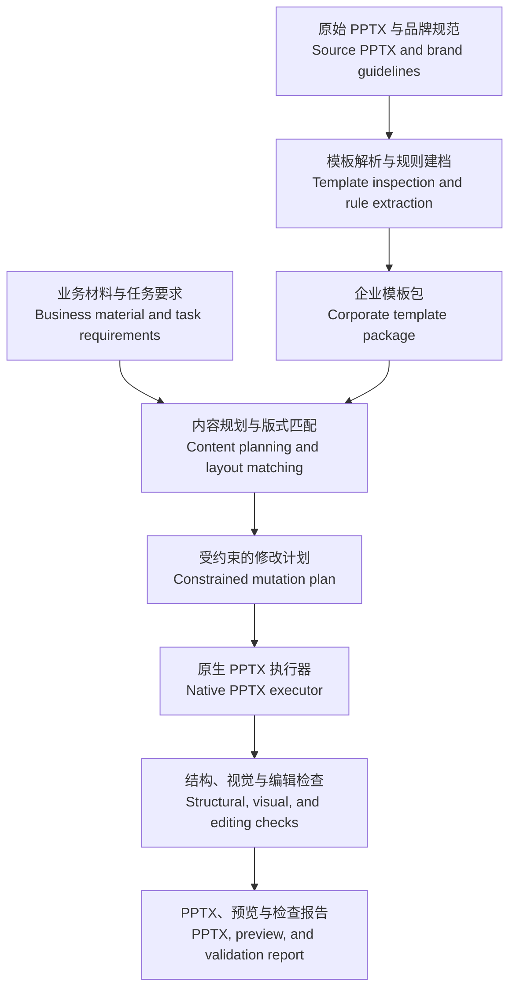

# QHY Corporate PPT

**遵循企业模板，保持品牌一致，交付可继续编辑的 PowerPoint。**  
**Follow corporate templates. Preserve brand consistency. Deliver PowerPoint files people can keep editing.**

企业模板驱动的 PPT Skill 框架，面向公司汇报、项目方案和周期性改稿。  
A framework for a corporate-template-driven PPT skill, designed for business reporting, project proposals, and recurring revisions.

> **当前状态：框架设计与本地模板登记。** 本仓库提供设计文档、实施路线，以及可运行的本地默认模板登记工具，尚未包含可安装的 Skill、生成引擎或经过验证的发布版本。维护者已有跑通的内部方案，后续将逐步整理并接入；演示文稿生产能力仍为设计目标。
>
> **Status: framework design and local template registration.** This repository contains the design, implementation roadmap, and a runnable utility for registering a local default template. It does not yet include an installable skill, a generation engine, or a validated release. The maintainer has reported a working internal workflow, which is planned for integration. Presentation production capabilities remain design targets.

## 为什么做这个项目 / Why this project

企业里的 PPT 经常需要交给同事继续修改，也需要在同一模板下不断更新。除了页面表达，交付还要满足具体要求：

Corporate presentations are routinely handed to colleagues for further editing and updated within the same template. Beyond communicating clearly, a deliverable must meet concrete requirements:

- **模板遵循**：保留公司母版、版式、页脚和页面结构。  
  **Template fidelity:** preserve corporate slide masters, layouts, footers, and page structure.
- **品牌保持**：使用原始 Logo，遵守比例、位置、安全区与颜色规则。  
  **Brand preservation:** retain original logos and follow their proportions, placement, clear space, and color rules.
- **字体与字号一致**：标题、正文、注释分别遵守对应规范。  
  **Consistent typography:** apply the approved font and size rules for titles, body text, and notes.
- **业务内容可编辑**：文字可以改，表格可以改单元格，图表可以改数据。  
  **Editable business content:** text can be rewritten, table cells updated, and chart data changed.
- **连续改稿可靠**：只更新指定内容，保留其他页面和人工修改。  
  **Reliable revisions:** update the requested content while preserving other slides and manual edits.

本项目把这些要求组织为明确的模板规则、受约束的修改流程和最终文件检查。支持范围将以真实模板及目标客户端的验证结果为准。

This project turns these requirements into explicit template rules, constrained editing workflows, and checks on the final file. Support will be defined by validation against real templates and target presentation applications.

## 四个工作入口 / Four workflows

以下为计划中的工作入口，并非当前可执行命令。  
These are planned workflows, not executable commands available today.

| 入口 / Workflow | 用户任务 / User task | 计划输出 / Intended output |
|---|---|---|
| `onboard` 模板建档 / Template onboarding | 将公司模板整理成可复用规则 / Turn a corporate template into reusable rules | 模板包、版式目录与支持边界 / Template package, layout catalog, and support boundaries |
| `generate` 按模板生成 / Template-based generation | 将业务材料做成公司格式的汇报 / Create a presentation from business material using the corporate template | 可编辑 PPTX、预览与检查报告 / Editable PPTX, preview, and validation report |
| `revise` 局部更新 / Targeted revision | 只改指定页的文字、图片或数据 / Update text, images, or data on selected slides | 新版 PPTX 与变化清单 / Revised PPTX and change receipt |
| `audit` 一致性检查 / Consistency audit | 检查是否符合公司模板与编辑要求 / Check template compliance and editability requirements | 按页和对象定位的问题 / Findings identified by slide and object |

## 工作方式 / How it is designed to work



Agent 负责理解内容、组织表达和匹配版式。确定性工具负责定位对象、执行修改、处理资源关系和验证规则。具体执行引擎将在整理内部实现后确定。

The agent interprets material, structures the presentation, and selects suitable layouts. Deterministic tools locate objects, apply changes, manage resource relationships, and validate rules. The execution engine will be selected after reviewing the internal implementation.

## 核心设计原则 / Core design principles

### 1. 原始模板是依据 / The original template is authoritative

保留源 PPTX 与版本指纹，区分母版型、示例页型和混合型模板。解析主题、继承和局部覆盖，避免仅凭截图或显式颜色值重建企业规范。

Keep the source PPTX and its version fingerprint. Distinguish master-based, example-slide-based, and mixed templates. Resolve themes, inheritance, and local overrides instead of inferring corporate rules solely from screenshots or explicit color values.

### 2. 明确哪些对象可以怎样改 / Define how each object may change

Logo 等品牌资产遵守固定规则；内容槽位允许替换文字或数据；图片槽位允许按规则换图和裁切；可重复组件在允许范围内增减。这里的约束作用于生成流程，不代表 PowerPoint 内的权限保护。

Brand assets such as logos follow fixed rules. Content slots allow text or data replacement. Picture slots allow approved replacement and cropping. Repeated components may change within defined limits. These constraints govern the generation workflow; they are not access controls inside PowerPoint.

### 3. 用实际编辑行为定义可编辑性 / Define editability through real editing actions

按业务需求检查原生文字、表格、图表和形状。Logo、照片和产品截图可以保留为图片；需要改数据的图表应保留对应数据结构。暂不支持编辑的复杂对象应保留原状并说明限制。

Check native text, tables, charts, and shapes against the required editing tasks. Logos, photos, and product screenshots may remain images. Charts that require data updates should retain the corresponding data structures. Complex objects that cannot yet be edited should be preserved and their limitations disclosed.

### 4. 内容容量不足时有明确处理 / Handle content overflow explicitly

优先选择合适的已有版式、拆页，或在允许的摘要范围内调整文案。字号只能在模板允许范围内调整。固定页数与完整保留内容发生冲突时，明确指出冲突。

Choose a more suitable existing layout, split content across slides, or rewrite within the permitted summarization scope. Font sizes must remain within the template's allowed range. Make conflicts between a fixed slide count and complete content retention explicit.

### 5. 从最终文件验收 / Validate the final file

检查最终 PPTX 的结构、品牌资产、有效字体与颜色、内容完整性及渲染效果。报告分别记录通过、失败和未运行；未经目标客户端实测，不声称兼容性已经验证。

Inspect the final PPTX for structure, brand assets, effective typography and colors, content completeness, and rendered appearance. Reports distinguish passed, failed, and not-run checks. Compatibility is not claimed without testing in the target application.

### 6. 保留用户的连续修改 / Preserve ongoing human edits

第二轮修改以用户最新的 PPTX 为基线，记录允许修改的对象和受影响的依赖，避免用旧内容计划覆盖用户已经完成的修改。

Use the user's latest PPTX as the baseline for subsequent revisions. Track the permitted object changes and affected dependencies so an outdated content plan does not overwrite manual edits.

## 交付与验收目标 / Deliverables and validation targets

计划交付：最终 PPTX、从该文件生成的预览、规则检查报告，以及改稿任务的变化清单。  
Planned deliverables: the final PPTX, previews rendered from that file, a validation report, and a change receipt for revision tasks.

| 维度 / Dimension | 验收目标 / Validation target |
|---|---|
| 模板结构 / Template structure | 母版、版式、占位符和资源引用符合契约 / Masters, layouts, placeholders, and resource references follow the contract |
| 品牌资产 / Brand assets | Logo 素材、比例、位置及可见性符合规则 / Logo assets, proportions, placement, and visibility follow the rules |
| 字体与色彩 / Typography and colors | 按角色检查有效样式与允许例外 / Validate effective styles and permitted exceptions by semantic role |
| 可编辑性 / Editability | 业务要求修改的对象支持对应原生编辑操作 / Required business objects support the intended native editing actions |
| 视觉质量 / Visual quality | 无未解决的严重溢出、遮挡或重影 / No unresolved severe overflow, occlusion, or duplicate text artifacts |
| 局部更新 / Targeted revision | 变化限定在允许范围，无意外跨页影响 / Changes stay within scope without unintended effects on other slides |

以上是设计目标，尚不是本仓库发布版本的实测成绩。  
These are design targets, not measured results from a released version of this repository.

## 默认模板 / Default template

使用 Python 3 将原始企业 PPTX 登记为本机的项目默认模板：

Use Python 3 to register an original corporate PPTX as this project's local default:

```bash
python3 scripts/template_registry.py set-default /path/to/company-template.pptx --id company-2027 --name "Company 2027"
python3 scripts/template_registry.py resolve
```

工具在 `local-templates/<id>/` 保存原始文件的完整副本、SHA-256 指纹和结构清单，并将 `local-templates/default.json` 指向该模板。解析默认模板时验证指纹；同一 ID 的不同文件需用新版本 ID 登记。可用 `--store <directory>` 指定独立模板库。

The utility keeps an intact source copy, a SHA-256 fingerprint, and a structural inventory under `local-templates/<id>/`. The local `local-templates/default.json` selects that template. Resolution verifies the fingerprint. Different files must use different version IDs. Use `--store <directory>` to select a separate template store.

项目中的 Agent 在未收到当次明确模板时读取此默认配置；局部改稿仍以用户最新 PPTX 为基线。工具仅完成登记、结构盘点和版本校验，尚不执行内容生成、Logo 识别、有效样式解析或视觉验收。

Agents working in this project read the default when the current task does not specify a template. Revisions still use the user's latest deck as their baseline. The utility handles registration, structural inventory, and version checks. It does not yet generate slides, identify logos, resolve effective styles, or validate rendered output.

模板库属于本地配置，已由 Git 忽略。克隆仓库后需自行登记模板；公开仓库不附带企业原始模板。

The template store is local configuration and is ignored by Git. Register a template after cloning the repository. Corporate source templates are not bundled in the public repository.

## 当前内容 / Repository contents

```text
qhy-corporate-ppt/
├── README.md                    中英文项目介绍 / Bilingual project introduction
├── AGENTS.md                    项目默认模板使用规则 / Agent template selection rules
├── docs/
│   └── framework.zh-CN.md       详细框架设计（中文）/ Detailed framework design (Chinese)
├── scripts/
│   └── template_registry.py     本地模板登记与解析 / Local template registration and resolution
└── .gitignore
```

阅读 [详细框架设计](docs/framework.zh-CN.md)，了解模块边界、对象修改契约、接口草案和验证场景。默认模板登记可按上文运行；生成引擎与 Skill 的安装步骤尚未提供。

Read the [detailed framework design](docs/framework.zh-CN.md) for module boundaries, object mutation contracts, draft interfaces, and validation scenarios. The template registry can be run as described above. Installation instructions for a generation engine or skill are not yet available.

## 实施路线 / Roadmap

- [x] 明确项目定位、四个入口及框架设计。  
  Define the project scope, four workflows, and architecture.
- [x] 建立独立仓库与中英文 README。  
  Establish a standalone repository and bilingual README.
- [x] 提供本地默认模板登记、结构清单与文件版本校验。<br>
  Provide local default template registration, structural inventory, and source fingerprint checks.
- [ ] 整理内部跑通方案，用一套真实模板建立可复现基线。  
  Integrate the internal workflow and establish a reproducible baseline with one real template.
- [ ] 实现模板建档、受约束修改及检查报告。  
  Implement template onboarding, constrained editing, and validation reports.
- [ ] 验证生成后人工修改、再局部更新的完整流程。  
  Validate generation followed by manual editing and subsequent targeted revision.
- [ ] 扩展不同类型模板，并公布客户端和对象支持范围。  
  Expand template coverage and publish the supported applications and object types.
- [ ] 提供可安装 Skill、公开示例和验证记录。  
  Release an installable skill, public examples, and validation records.

首版优先做好一套模板的完整流程，再验证多母版、长标题、缺失字体、共享图表和跨客户端差异。  
The first milestone focuses on a complete workflow for one template, followed by tests for multiple masters, long titles, missing fonts, shared charts, and differences between applications.

## 参考与关系 / References and relationship

本项目参考 [PPT Master](https://github.com/hugohe3/ppt-master) 的模板分层、原生结构与原文件编辑思路。PPT Master 已包含相关能力，本项目聚焦企业规则的明确表达、受约束执行、验收和持续改稿。

This project draws design inspiration from [PPT Master](https://github.com/hugohe3/ppt-master), particularly its template separation, native presentation structures, and source-preserving editing workflow. PPT Master already includes related capabilities. This project focuses on explicit corporate rules, constrained execution, validation, and recurring revisions.

这是独立项目，当前仓库未包含 PPT Master 源代码，也未将其设为运行依赖。未来如复用第三方实现，将保留相应许可证与署名。

This is an independent project. The current repository includes no PPT Master source code and does not declare it as a runtime dependency. Any future reuse of third-party implementations will retain the applicable licenses and attribution.

- [模板架构 / Template architecture](https://github.com/hugohe3/ppt-master/blob/c350bc31e6d43b7bcf5234183d650ba8f9f4c9d7/docs/templates-architecture.md)
- [原生 PPTX 编辑流程 / Native PPTX editing workflow](https://github.com/hugohe3/ppt-master/blob/c350bc31e6d43b7bcf5234183d650ba8f9f4c9d7/skills/ppt-master/workflows/edit-native-pptx.md)
- [母版、版式与占位符接口 / Master, layout, and placeholder interface](https://github.com/hugohe3/ppt-master/blob/c350bc31e6d43b7bcf5234183d650ba8f9f4c9d7/skills/ppt-master/references/pptx-structure-interface.md)

## 反馈 / Feedback

欢迎通过 [Issues](https://github.com/haoyu-qi/qhy-corporate-ppt/issues) 描述实际需求：使用场景、模板类型、必须可编辑的对象，以及目前最费时间的修改步骤。

Use [Issues](https://github.com/haoyu-qi/qhy-corporate-ppt/issues) to describe your use case, template type, objects that must remain editable, and the editing steps that currently take the most time.

请使用脱敏描述或获准公开的示例，不要在公开 Issue 中提交公司内部模板或业务材料。  
Use anonymized descriptions or examples approved for public sharing. Do not submit internal corporate templates or business material in public issues.
